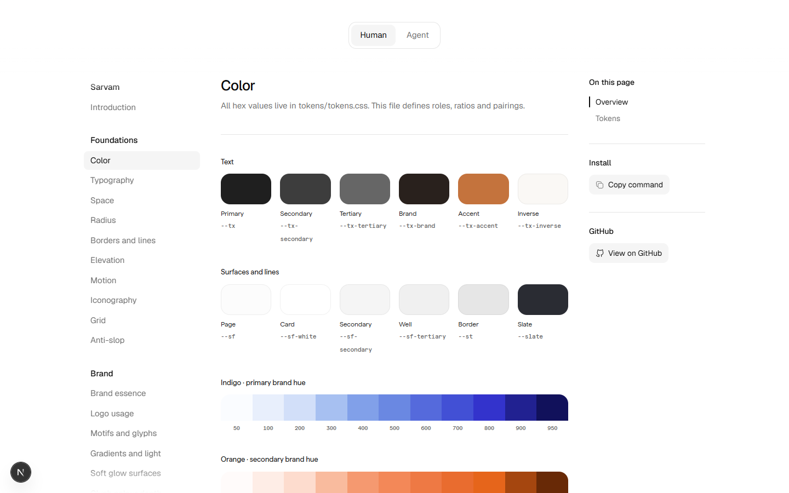
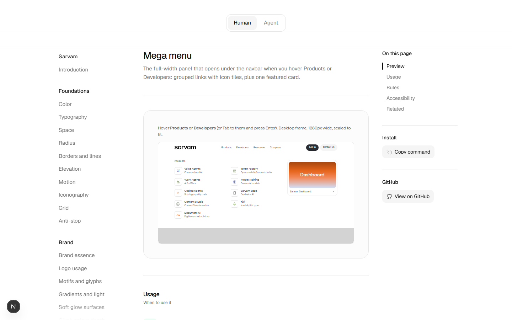
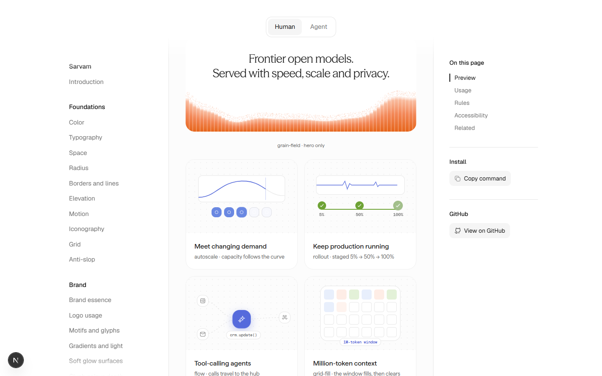

<p align="center">
  <picture>
    <source media="(prefers-color-scheme: dark)" srcset="sarvam-design-system/assets/logos/sarvam-wordmark-white.svg">
    
  </picture>
</p>

<h3 align="center">Sarvam design system skill</h3>

Sarvam AI's brand, written as an agent skill. Load it into Claude Code, Cursor, Codex or another coding agent, and it produces on-brand Sarvam websites, UI, social banners, embed images and animations. It uses Sarvam's real production tokens, type, components and visual language, and follows the rules for when and how to use each. A companion docs site shows every foundation and component live.

<p align="center">
  
  
  
</p>

## Install

```bash
npx skills add bikash1376/sarvam-design-system-skill --skill sarvam-design-system
```

This installs the skill into every coding agent it finds on your machine (Claude Code, Cursor, Codex and others). Run it again to update. Once it's installed, just ask for anything branded Sarvam, for example "a landing page for Saaras V4", "a LinkedIn post announcing Bulbul" or "an OG image for the docs", and the skill takes over.

## How the skill works

- **One source of truth.** `tokens/tokens.css` holds colour, type, spacing, radius, shadows, gradients and motion tokens measured from sarvam.ai. Then come 17 foundations (colour, typography, layout and responsive behaviour, motion, logo, copywriting and more), 68 component specs, and formats for web pages, hero layouts, banners and embed images.
- **It asks before it builds.** For a website, the agent first asks a few multiple-choice questions (stack, pages, audience, sections), skipping any your prompt already answers. Then it writes the copy, picks the hero layout for the audience, builds, renders at 375 / 768 / 1440, and finishes with a QA and taste pass.
- **Websites are built on a shared baseline:**
  - **React + Tailwind CSS v4** (Vite by default, or Next.js or Astro)
  - **shadcn/ui on Base UI** for primitives, themed by a scoped `.sarvam` layer, so stock components become Sarvam components without shifting anything else
  - **Motion** for all animation, **torph** for morphing text, and **Lenis** for smooth scrolling
- **Banners and posts are static HTML rendered to PNG.** Six platform canvases share one proportional type scale, so a banner keeps its proportions on Meta, LinkedIn, Instagram stories and X. A decision layer (ad or post, hue story, motif, copy move) comes from ~35 official Sarvam posts.
- **Facts are guarded.** Numbers, customers and quotes come only from `FACTS.md`. If a claim isn't there, the copy is rewritten so it doesn't need one.

### Where it draws from
- **Sarvam itself:** sarvam.ai production CSS and markup, sarvam.ai/brand and brand guidelines, the official mandala and gateway glyphs, and official LinkedIn and WhatsApp posts.
- **Bundled skills,** each adapted so Sarvam's tokens, fonts and motion always win:
  - [ui-ux-pro-max](https://github.com/nextlevelbuilder/ui-ux-pro-max-skill) (MIT): banner art direction, platform sizes, UX search.
  - [Emil Kowalski's skills](https://github.com/emilkowalski/skills) (MIT): animate, choreograph, animation-performance, animation-vocabulary, design engineering, and pick-ui-library.
  - [Anthropic skills](https://github.com/anthropics/skills) (Apache 2.0): algorithmic-art and canvas-design, for generative ornament and illustration.
  - [taste-skill](https://github.com/Leonxlnx/taste-skill) (MIT): the final taste and anti-slop pass.

## FAQ

**Will it change Sarvam's brand?**
No. It encodes the existing brand. Small extensions (the inputs, overlays and AI components sarvam.ai doesn't ship) follow the same tokens and rules.

**Which tools does it work with?**
Any agent that reads skills or markdown: Claude Code, Cursor, Codex and others. Without an agent, point any model at `sarvam-design-system/SKILL.md`.

**Do I need the docs site to use the skill?**
No. The skill is self-contained. The docs site (`sarvam-design-system-docs/`, Next.js) is for people: open it with `npm install && npm run dev`, then switch between **Human** (live previews and rules) and **Agent** (the raw spec the agent reads).

**Can I use the fonts?**
Season Mix and Matter are licensed to Sarvam and included for internal use only. Don't redistribute them.

**Where do I change a rule?**
In `sarvam-design-system/` (start with `SKILL.md`, which maps every file). The docs site reads from it, so it updates on the next run.
