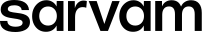

# Reusable snippets

## Film grain overlay (put inside any banner or section; z above bg, below text)
```html
<div class="grain"></div>
<style>.grain{position:absolute;inset:0;pointer-events:none;opacity:.06;mix-blend-mode:multiply;
background-image:url("data:image/svg+xml;utf8,<svg xmlns='http://www.w3.org/2000/svg' width='240' height='240'><filter id='n'><feTurbulence type='fractalNoise' baseFrequency='.9' numOctaves='3' stitchTiles='stitch'/><feColorMatrix values='0 0 0 0 0  0 0 0 0 0  0 0 0 0 0  0 0 0 1 0'/></filter><rect width='100%' height='100%' filter='url(%23n)'/></svg>")}</style>
```

## Gateway mask for photos
```css
.gateway-mask{ -webkit-mask:url(../assets/motifs/gateway-arch.svg) center/contain no-repeat; mask:url(../assets/motifs/gateway-arch.svg) center/contain no-repeat; }
```

## Partner lockup
```html
<div class="lockup"><span style="width:1px;height:18px;background:#b3b3b3"></span><span style="font:400 14px var(--font-label);letter-spacing:.08em;text-transform:uppercase">Voice Agents</span></div>
```
